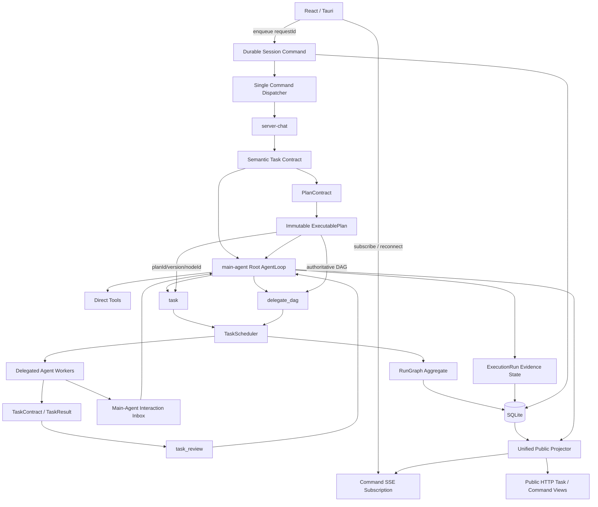

# Eval 主 Agent 与多 Agent 当前架构剖析

> **历史文档说明（2026-08-09）：** 本文保留 2026-07-23/29 的架构分析过程，其中
> `task_review`、Claim、评分验收、`waiting-review`、`revision-required` 和 DAG fail-fast
> 描述已经失效。当前实现以
> [`agent-execution-loop-architecture.md`](./agent-execution-loop-architecture.md) 为准。

> 初始日期：2026-07-23
>
> 当前实现复核：2026-07-29
>
> 范围：`embedded-agent` 当前工作区代码
>
> 文档性质：已实现架构、已生效不变量与真实剩余限制。本文不把未实现方案写成现状。

## 1. 结论

Eval 当前采用“每会话稳定主 Agent owner + 严格根级编排工具 + 受契约约束的执行
Worker + 持久化运行图”的架构。

已实现的核心不变量是：

1. 每个会话创建一次稳定的 `main_agent_instance_id`。所有根运行、恢复段、子任务仲裁和最终
   交付都归属于这个 owner；专业 Agent 和模型切换不能替换它。
2. `task`、`delegate_dag`、`task_review` 同时检查 `runType=root` 和
   `agentId=main-agent`。子 Agent、工作流节点以及伪装成根运行的专业 Agent 都不能获得编排权。
3. 子 Agent 的正文、工具流、身份和运行谱系是内部控制面数据。需要用户回答或审批时，子 Agent
   只能提交内部交互请求，再由主 Agent 边界持久化、净化和重新归属后对外发布。
4. 任务含义由模型返回严格结构化的语义 contract。运行时验证枚举、Agent、工具效果、验收证据
   和字段组合；不从用户原文、todo、恢复说明或 Agent 名称中使用关键词推断权限、角色或完成条件。
5. 多原子任务可通过 `delegate_dag` 一次提交。无依赖且资源不冲突的节点并行；依赖节点按图
   顺序执行；读写冲突节点串行；任一分支失败会取消并汇合兄弟 Worker。
6. 子 Worker 的 `completed` 只表示已经提交 `TaskResult`。逻辑子任务必须进入
   `waiting-review`，由同一会话的主 Agent 使用 `task_review` 完成证据约束的仲裁。
7. 调度器维护任务树终态屏障。根 Worker 返回、失败或收到取消请求后，只要后代仍在运行、
   取消中或等待评审，根任务就不能发布终态，也不能释放会话 lane 或冲突资源。
8. `RunGraph` 按全部节点聚合图状态。普通调度状态变化把 `task_runs`、图节点、图聚合状态、
   图版本事件和绑定的 session command 终态放在同一个 SQLite 事务中。
9. 用户输入先成为 durable session command，再由单一 dispatcher 按会话 FIFO 消费。SSE 是
   可断开、可重连的订阅投影；浏览器断线不会取消命令，也不会取得执行 owner 身份。
10. 控制平面使用 leader lease 和 owner epoch fencing。失去租约的旧进程不能重新绑定或结束
    已被新 owner 接管的命令。
11. 软件、文档或代码审查目标中新增的实机烧录、接线、串口观察等建议进入 `followups`，由用户
    后续执行，不计入当前任务未完成数。只有用户原始结构化验收明确要求
    `hardware-observation` 时，硬件条件才可以阻塞该目标。
12. 所有实时 SSE、持久化 `run_events` 和断线重放共用一个显式白名单的公共事件投影器。内部
    Agent 身份、运行谱系、工具输入、模型思考、租约、原始错误和调度协议不能从其他出口绕过。
13. 用户选择的会话模型与内部协议探测相互独立。模型能力按
    `provider + baseUrl + modelId + credential revision` 形成 wire identity，并由多次独立观测
    仲裁；单次失败、限流、超时或配额错误不能把模型永久降级。
14. 执行循环同时受总运行时长、根执行窗口、恢复策略数、子任务修订次数和子任务尝试次数的
    持久硬预算约束。达到边界时保留可续接快照，但不能伪造完成或无限原样重试。
15. 模型提交的 `PlanContract` 只在边界解析一次。运行时把它编译为带
    `planId + version + fingerprint` 的深度冻结 `ExecutablePlan`，并由此唯一生成调度 DAG 和
    每个节点的 `TaskContract`；后续 `task/delegate_dag` 只能引用计划节点，不能重写依赖、角色、
    资源、效果或验收。
16. 通用 shell 与嵌入式构建是两种不同的宿主机能力。`ProcessCapabilityBroker` 在创建进程前
    按可执行文件身份、包装层和目标目录审计命令；`bash/cmd/PowerShell/npm` 等包装器不能绕过
    `compile`。内置编译只接受结构化 ESP-IDF 请求，内置下载只接受认证的 ESP 多镜像清单以及
    USB Serial/JTAG、USB CDC 或 UART 传输。
17. 公共边界覆盖 SSE、持久事件、历史重放和 HTTP 任务/命令 API。它们共用同一组公开 schema，
    不存在通过状态查询返回原始 TaskRun、子 Agent 结果、工作目录或错误对象的旁路。

## 2. 四种不能混淆的 owner 身份

| 身份 | 生命周期 | 当前用途 |
|---|---|---|
| `main-agent` | 进程内永久注册的角色定义 | 唯一 primary 角色和所有会话根运行的业务身份 |
| `main_agent_instance_id` | 每个会话稳定，当前格式为 `main-<sessionId>` | 跨根运行、恢复和重启保持仲裁及交付所有权 |
| 根 `taskId/runId` | 一次根执行 | 调度、取消、ExecutionRun、RunGraph 根节点和事件归属 |
| `ownerEpoch + ownerToken` | 后端进程租约和一次命令 claim | 防止两个进程或陈旧 Worker 同时消费、绑定或结束一条命令 |

`main_agent_instance_id` 是业务 owner，不是进程锁；`ownerEpoch` 是进程 fencing token，不是
对话角色。模型 ID、供应商、Slash command、用户选择的专业角色和自动分类都不属于 owner。

`SessionRepo.create` 只在会话创建时生成 `main_agent_instance_id`。`selectRuntimeAgent` 始终
返回 `main-agent` 作为根 `agent`，并把专业角色放在 `executionAgent`。会话恢复产生新的根
`runId` 时，`task_review` 仍读取同一个会话 owner，因此可以接管旧的 `waiting-review` 结果。

## 3. 当前控制面



### 3.1 持久化对象按职责分工

系统没有用一张表承担所有语义。当前权威事实按职责拆分：

| 对象 | 权威内容 |
|---|---|
| `sessions` | 稳定主 Agent owner、会话配置和上下文归属 |
| `session_commands` | 用户命令 FIFO、幂等 request、claim owner、绑定根任务和公开终态 |
| `task_runs` | 调度生命周期、lane、父子关系和 Worker 终态 |
| `execution_runs` | AgentLoop 待办、证据、恢复 contract、验证缺口和停止原因 |
| `run_contracts` | 子任务输入 contract、完整 TaskResult、仲裁和 revision 链 |
| `run_graphs/run_graph_nodes/run_graph_edges` | 根、委派、工作流、评审节点及图聚合状态 |
| `run_graph_events` | 带图版本的内部状态变化 |
| `run_events` | 面向会话订阅的可重放公开事件 |
| `main_agent_interactions` | 子 Agent 请求主 Agent 处理的内部问题和审批 |
| `model_protocol_capabilities/observations` | 模型原生工具协议能力、独立观测作用域和仲裁状态 |
| workflow 表 | 显式工作流模板、节点配置、调度和重试状态 |

因此，`execution_runs` 不是整个多 Agent 系统的唯一真相源；它只拥有 AgentLoop 的语义执行
快照。任务树终态由调度器屏障和持久化 task 状态约束，图级公开状态由 RunGraph 聚合。

## 4. 严格的根级编排边界

### 4.1 双重拒绝

三个编排工具均在执行入口检查：

```text
ctx.runType === "root"
ctx.agentId === "main-agent"
```

少任一条件都失败关闭。非 primary Agent 的 capability manifest 也不声明这些工具，所以边界
同时存在于工具可见性和工具执行入口，不依赖提示词自律。

| 工具 | 主 Agent 权限 |
|---|---|
| `task` | 发布一个结构化原子子任务或独立 reviewer |
| `delegate_dag` | 一次发布最多 12 个带依赖和资源声明的原子子任务 |
| `task_review` | 对一个已提交 TaskResult 的逻辑任务进行最终仲裁 |

子 Agent 可以使用 `todowrite` 或 `plan` 管理自己的执行，但不能继续创建子
Agent、创建委派 DAG 或仲裁其他任务。

### 4.2 子 Agent 交互不能越过主 Agent

子 Agent 需要用户输入或工具审批时，产生：

```text
SubAgentInteraction {
  type: "question-request" | "approval-request"
  requiresMainAgentReview: true
  visibility: "internal"
}
```

`mainAgentInteractionInbox` 以 `rootRunId + sourceId + kind` 幂等持久化该请求。
`brokerSubAgentInteraction` 将公开 `runId` 改为根运行，清理子 Agent、child run 和内部协议
描述，再交给问题或审批管理器。用户结果沿相同边界返回等待中的子 Worker。

没有主 Agent broker 的 headless 子 Worker 请求会失败关闭，不会直接写入公共问题或审批管理器。
普通子 Agent 正文、工具调用和活动事件也不会进入公共 SSE。

### 4.3 进程能力不是 shell 参数

工具白名单只解决“谁可以请求工具”，进程能力 broker 进一步解决“该工具实际可以启动什么”。
所有通用 shell 调用在创建进程前进入 `authorizeShellProcess`：

- 直接编译驱动、编译器和 `idf.py/make/ninja/cmake --build` 被识别为
  `embedded-build`，只能转由 `compile`；
- `cmd /c`、`PowerShell -Command`、`sh -c`、`bash -lc` 会递归检查内层命令；
- 编码命令、脚本文件、包管理器脚本和不能在边界内证明行为的包装器归为
  `opaque-process`，在受管硬件工作区失败关闭；
- 受管硬件工作区的通用 shell 只保留 `rg`、只读 Git、哈希等诊断能力；
- 判定基于可执行文件身份、参数结构、目标目录和项目元数据，不读取用户句子或模型解释。

因此，模型即使改写命令、增加一层 shell 或通过包脚本间接启动构建，也不能获得 `compile`
拥有的 ESP-IDF 进程能力。非 ESP 工程继续允许源码和文档工作，但内置编译与下载在进程启动前
拒绝。

## 5. 语义 contract：模型理解，运行时验证

### 5.1 请求级任务 contract

每个新执行请求在调度前只进行一次模型语义分析，结果必须完整包含：

```text
goalType
complexity: simple | compound | complex
requiredEffects: ToolEffect[]
candidateAgentIds: non-primary Agent ID[]
requiresPlanning: boolean
acceptanceRequirements[]:
  id
  label
  anyOf: typed evidence kind[]
  targetPatterns[]
source: model
```

该 contract 同时驱动是否规划、专业执行角色选择、能力校验、Objective 编译和运行时验收。
`requiredEffects` 表示完成目标需要什么能力，不是授权；最终工具可见性仍受 Agent 白名单、
TaskContract resource capability、执行 scope、系统策略和用户审批共同约束。

模型不提交 `verifier`。运行时根据每个 `anyOf` 的证据集合求共同兼容 verifier；存在多个
兼容候选时再用 `goalType` 做确定性消歧，例如 hardware 目标优先 `hardware`，research 目标
优先 `research`，其余检查目标优先 `workspace-inspection`。没有共同 verifier 的异构证据组合
严格拒绝。这样避免模型同时生成 `schematic-inspection` 和 `source-inspection` 之类互相冲突
的冗余字段，也不把验收权交给提示词。

以下情况在根任务入队前失败关闭：

- 没有可用语义模型或候选模型；
- 空输出、无效 JSON、缺失字段或额外字段；
- 未知 goal/effect/evidence，或模型额外提交运行时拥有的 `verifier`；
- primary、未知或不可委派 Agent ID；
- verifier 与 evidence kind 不兼容；
- `complex` 却没有 `requiresPlanning=true`。

失败后，已 claim 的 durable command 使用 owner-fenced `finishOwned(failed)` 关闭，不遗留
`processing` 命令。系统不会把错误结果静默降级为 `general`。

### 5.2 不再存在的文本推断

当前实现不从下列文本推断效果、角色、验收或恢复工具：

- 用户输入中的“修改”“编译”“继续”等词；
- todo 标题或 acceptance 说明；
- 恢复步骤的 `instruction` 或 `nextActions`；
- Agent ID、provider 或 model ID。

`objective-compiler` 缺少已验证的 semantic analysis 时直接抛出
`structured-objective-intent-required`。需要工具证据的 AgentLoop 缺少
`objectiveAcceptancePolicy` 时，在模型调用前抛出
`objective-acceptance-policy-required`。

子任务和工作流节点不重新解释自然语言，而是从父级 `TaskContract.acceptanceCriteria`
投影不可削弱的验收策略。恢复循环只读取结构化
`recoveryCandidates[].steps[].tools/effects`；说明文本只用于模型理解和 UI。

每个候选恢复策略进入持久化 `recoveryLedger`，记录 available、active、failed、succeeded、
动作位置和尝试次数。普通工具没有提供领域候选时，运行时根据工具执行语义生成有界的
“检查前置条件后调整重试”和“改用同效果授权能力”候选，不解析错误文本。相同工具、语义输入
和进展版本已经失败时，工具边界直接拒绝原样重放；只有新的可信证据或工作区变更推进
`progressRevision` 后才允许重新验证。

### 5.3 会话回合 contract

非首次回合使用另一份正交 contract：

```text
mode: execute | query | discuss | context
executionTarget: open-objective | latest-run | latest-plan | new-objective | none
queryTarget: run-status | domain | none
objectiveId?
taskId?
proposal?
```

运行时先验证字段组合，再确定性导出 `resume-objective`、`resume-plan`、`status-query`、
`new-objective` 或普通对话。只有 `execute/open-objective` 可以绑定开放目标；
`query/domain` 创建新的信息审查目标；`query/run-status` 只读取运行账本。仅存在一个开放目标
本身不足以触发续接。

### 5.4 模型协议能力仲裁

会话模型选择只决定本轮对话使用哪个公开模型；内部原生工具协议能力由独立的观测账本决定，
不按 provider 名称或 model ID 硬编码。观测键包含 provider、规范化 base URL、model ID 和
凭据修订号，避免不同网关或账号互相污染。

- 一次显式协议拒绝只记为 unknown，不立即隔离模型；
- 至少两个独立且结论性的观测作用域一致失败，才标记 unsupported；
- 同一作用域的成功重试覆盖该作用域旧失败；
- 网络、配额、取消、限流和普通服务错误属于 transient，不参与不支持判定；
- 已验证模型不会因一次 forced-tool 失败被降级；
- 内部探测或工具模型切换不能改写用户在会话输入框中选择的模型。

### 5.5 `PlanContract` 到运行时权威计划

复杂目标的规划结果不是 Markdown 待办，也不是后续模型可以反复解释的提示词。模型只提交
严格的 `PlanContract`：

```text
planId + version
nodes[] {
  nodeId, dependsOn, assigneeAgentId
  requiredEffects, resources
  acceptance { id, label, anyOf, targetPatterns }
  expectedOutputs, blockingClass
}
```

计划 schema 不接受模型提供 `verifier`。运行时按节点的 `goalType + anyOf` 派生 verifier，
注入效果对应的机械验收下限，再将规范化 contract 编译为深度冻结的 `ExecutablePlan`。其身份
由 `planId + version + canonical SHA-256 fingerprint` 组成。

`ExecutablePlan` 是本次根运行的计划权威：

1. `compileExecutablePlanDag` 从冻结节点生成准确的依赖图和资源声明；
2. 每个节点预编译不可削弱的 `TaskContract` 和稳定 `logicalTaskId`；
3. 计划激活后，根 Agent 的直接领域工具被收窄为计划控制工具；
4. `task/delegate_dag` 必须提交 `planId/version/nodeId`，运行时从权威计划实例化任务；
5. 调用中重复给出的角色、依赖、效果、读写集合、验收或输出只用于一致性校验，任何差异都拒绝；
6. 修订只能附加主 Agent 仲裁要求和新的输入 artifact，不能改写原节点合同。

规划阶段拥有独立的控制平面能力租约。自动规划尚未提交权威计划时，运行时把领域
`objectiveEffects` 置空，只开放该阶段声明的控制工具；进入执行阶段后再恢复用户授权的领域
效果。每个阶段在第一次模型调用前还会检查 `requiredPhaseTools` 是否真实可见，缺失时以
`execution.contract-rejected` 失败关闭，不能让模型在一个无法满足的工具合同中盲目运行。

节点验收条件必须在 `TaskContract` 规范化之前参与效果派生。这样纯外部研究节点只要求
`network`，不会因为默认验收器的中间态被错误提升为 `process`；编译后的效果集合仍由
`ExecutablePlan` 冻结并在委派边界逐项核对。

公开 Markdown 始终由 contract 渲染，只用于用户阅读。它不能反向驱动调度，也不能成为第二份
计划真相源。

## 6. 委派 DAG 的实际执行语义

### 6.1 发布前验证

`delegate_dag` 在挂起父任务前完成：

- 当前运行存在计划时，校验 `planId/version`，并从 `ExecutablePlan` 编译节点集合；
- 节点 ID、数量和验收条件校验；
- 子 Agent 存在且不是 primary；
- 依赖端点存在、自依赖拒绝、循环检测；
- 资源声明规范化；
- 完整运行时依赖检查。

任何校验失败都不会让父任务进入 `waiting-delegation`。存在权威计划时，调用者不能添加计划外
节点，也不能以第二份模型生成的 DAG 替换依赖图。

### 6.2 并行、依赖和资源冲突

一个 DAG 只挂起并恢复父任务一次。运行规则为：

1. 全部依赖成功的节点成为 ready。
2. ready 节点与当前 running 节点资源不冲突时并行启动。
3. 写/写和写/读冲突必须串行；只读或不相交资源可以并行。
4. 依赖节点只接收已经成功的前驱 `run-result` artifact 引用。
5. 每个真实子任务仍经过 durable enqueue、TaskContract、RunGraph 绑定、租约和权限边界。

调度器再次检查资源冲突，因此模型给出的节点顺序不能绕过并发安全。可写 Agent 没有可证明的
精确写集合时使用 `workspace:**` 保守互斥。

### 6.3 失败是图级失败

任一节点失败或父任务取消后：

- group AbortSignal 传播到已启动节点；
- 调度器取消兄弟 Worker；
- DAG 在有界时间内等待真实 Worker exit；
- 尚未启动的依赖节点记录为未启动；
- 已经短暂到达 `waiting-review` 的成功兄弟也会被本次原子委派事务撤销，不能作为可仲裁成功
  暴露给主 Agent；
- 不响应取消的 Worker 返回 `waitingWorkerExitNodeIds`，资源租约继续保留，不伪造退出。

这里的“原子”是编排结果语义：一个失败 DAG 不暴露部分成功。它不代表文件系统已经具备跨文件
原子提交；该限制见第 12 节。

### 6.4 显式 Workflow 路径

`WorkflowEngine` 保留一条面向模板、定时计划和 Webhook 的持久化 DAG 路径。它与
`delegate_dag` 的图来源不同，但 Worker 仍进入同一个 TaskScheduler、资源冲突判断、
TaskContract/TaskResult、ExecutionRun 和 RunGraph：

- workflow 表保存模板节点、依赖、条件、重试和人工接管状态；
- 同一 ready layer 最多选取三个节点，并按 sibling failure policy 汇合；
- fail-fast 会先请求取消同批 Worker，再等待全部 promise settle；
- workflow node 使用 `runType=workflow-node`，不能调用根级编排工具；
- node acceptance criteria 投影为 AgentLoop 的 typed evidence policy；
- Worker 先提交 `waiting-review`，再由绑定 stable main owner 的 unattended Acceptance Gate
  逐条派生检查并决定 accepted 或 revision-required；
- retry 保留前一 `taskRunId`，通过 `revisionOf/revises` 建立不可削弱的返工链。

Workflow 的控制状态尚未全部下沉到 RunGraph，这是当前真实双控制面边界，详见 12.1。

## 7. TaskResult 与主 Agent 仲裁

### 7.1 Worker 提交不是逻辑完成

子 Worker 结束后持久化：

- 标准化状态、摘要和完整输出；
- artifact 引用；
- 带 evidence kind、target 和时间边界的工具证据；
- 未关闭事项；
- 执行控制器证据。

随后 task、RunGraph 节点以及可写资源进入 `waiting-review` 屏障。父 Agent 只获得预览和
`run-result:<runId>` 引用，完整结果保留在 `run_contracts`。

### 7.2 `task_review` 的通过条件

`task_review` 只接受当前会话的 stable main owner，并要求：

- 每个 `TaskContract.acceptance` 都有同名 `acceptance_check`；
- evidence/artifact 引用属于本次 TaskResult；
- 证据类型、目标路径和证据时间满足对应 criterion；
- 预期输出真实存在；
- 五个维度完成评分：目标、验收、证据、交付物、完整性；
- 要求独立复核时，提供由不同角色执行且已通过主 Agent 仲裁的 `review_of` 结果。

低于阈值或存在事实缺口时进入 `revision-required`，并要求非空 `revisionPlan`。下一次尝试通过
`revision_of` 建立因果链；修订只能增加细化要求，不能删除原目标、验收、资源和独立复核义务。

一个 `delegate_dag` 返回的所有 `waiting-review` 结果会一次性折叠进主 Agent 的
`taskReviews` 账本，根循环不会只看到一部分待评审节点。只有逐个 `task_review` 接受后，相关
逻辑任务才从完成门中移除。

## 8. 任务树终态屏障

调度器区分“Worker 执行体已返回”和“整棵任务树已终结”。

### 8.1 完成

根 Worker 请求 `completed` 时，若存在 running、queued、cancelling、suspended 或
`waiting-review` 后代，调度器保存 terminal intent，把根放入 `waiting-delegation`。最后一个
后代退出或通过仲裁后，根才原子写入 `completed`。

### 8.2 失败和取消

根失败或取消会递归取消后代。带 `onCancel` 的 Worker 先进入 `cancelling`，继续占有 lane 和
资源；只有 `confirmWorkerExit` 才能释放。重复取消是幂等请求，不能替代真实退出确认。

若 Worker 已退出但 ChangeSet 回滚无法证明完成，节点转入 `waiting-review`，继续保留资源
屏障，不能伪造 cancelled/failed 终态。

### 8.3 持久化评审屏障

`waiting-review` 不属于有界终态历史。服务重启后，调度器从 `run_contracts/task_runs`
重建 review barrier 和资源声明，不重放子 Agent，也不允许冲突写任务越过未仲裁结果。

## 9. RunGraph 聚合与事务边界

RunGraph 节点类型为 `root | delegated | workflow | review`，边类型为
`depends-on | revises | reviews | blocks`。

`aggregateRunGraphStatus` 以整图计算状态：

- 有 live descendant 时，根即使已经返回也只能是 `running` 或 `waiting`；
- delegated child 的 `accepted` 不能把仍运行的根图变成 completed；
- `waiting-review`、`revision-required` 和等待交互属于 live/waiting；
- 只有根节点 `accepted` 且没有 live descendant 时，根图才是 `completed`；
- 失败、取消和中断从根事实投影为对应图终态。

普通调度转换通过 `RunGraphRepo.transitionNodeAndTask` 在一个事务内提交：

1. `task_runs` 状态和结果；
2. 绑定 session command 的终态；
3. RunGraph 节点状态和 result ref；
4. 重新聚合的 graph 状态；
5. graph version；
6. `node-status` graph event。

持久化失败时，`TaskScheduler.commitUpdate` 不发布内存变化。公开任务状态优先读取根 RunGraph；
图缺失时 API 返回明确的 degraded integrity 状态，而不是无限轮询或悄悄回退成成功。

出于内部协作隔离，公共 RunGraph API 当前只投影根节点和图版本；子节点与边仍保留在内部
RunGraph 和诊断面。

## 10. Durable session command、SSE 与 fencing

### 10.1 Durable command

用户命令先写入 `session_commands`：

```text
pending -> processing -> accepted -> completed | failed | cancelled
```

- `requestId` 全局幂等；同一 ID 绑定其他会话或 payload 返回冲突。
- `sessionSeq` 分配和 insert 位于同一事务。
- claim 只允许会话中最早的非终态命令。
- 一个会话同一时刻只有一个 owner；不同会话可以并发。
- `accepted` 表示命令已经绑定 durable root TaskRun，不表示任务完成。

### 10.2 SSE 只是订阅

`/api/session-commands/stream` 从持久命令查找绑定任务并读取 `run_events`。订阅者取消或网络
断开不会改变 command 状态。重连会重新发出 `session` 绑定并按事件 ID 重放；命令已经终态但
缺少历史 `done` 事件时，订阅层从 command/TaskRun 合成一次终态包。

任务状态 API 同时返回待审批和待回答问题，因此 SSE 丢失不隐藏交互门。前端以 taskId 和权威
快照决定任务状态；带 ID 的事件用于可恢复日志和幂等投影，不根据聊天正文推断完成。

### 10.3 Owner fencing

后端启动时获得唯一 `runtime_leader_lease`。活动 leader 存在时，第二个控制平面进程拒绝并行
调度；leader 心跳过期或丢失时，旧进程停止调度并退出。

每个进程还维护 `runtime_owner_leases.owner_epoch`：

- `tryClaim` 只接受活跃 epoch；
- `bindTask` 和 `finishOwned` 同时校验 ownerToken 和未过期 epoch；
- 另一活跃 epoch 的命令不能被抢占；
- 只有旧 epoch 过期或显式退休后，新进程才可把 `processing` 恢复为 `pending`；
- 旧 Worker 即使稍后恢复运行，也无法覆盖 replacement owner 的绑定或终态。

运行中的命令取消保持 `accepted`，直到 Worker exit acknowledgement 使任务树真正终结；这样
下一条命令不会越过仍持有资源的前任。

dispatcher 也会主动收敛同一进程内遗留的队首状态，而不是只处理 `pending`：

- 同 epoch 的 `processing` 没有建立根任务时，以 owner token 围栏失败关闭；
- `accepted` 绑定的 TaskRun 不存在时，通过 `finishAcceptedOwned` 以
  `ownerEpoch + requestId + taskId` 围栏关闭；
- 绑定任务已经终态时，command 同步为对应终态；
- 绑定任务仍在 scheduler 中时继续等待，不重复执行；
- durable TaskRun 非终态但已不在 scheduler 中时，先标为 `interrupted`，再同步命令终态。

dispatcher 始终选择会话中最早的非终态命令，因此无法被恢复的 `accepted` 孤儿不会被跳过，也
不会永久阻塞后继 FIFO。

### 10.4 前端只消费后端权威队列

前端启动时先水合 `session_commands`，再提交本地尚未持久化的输入并订阅当前会话命令。组件
内的 `isStreaming`、Effect 次数和 SSE 连接状态不再决定 FIFO：

- UI 不再直接调用 `/api/chat` 建立另一条首连；每次用户输入只通过
  `/api/session-commands` 接纳，再由唯一 command consumer 订阅；
- 后端 dispatcher 是唯一消费者，同一会话只 claim 最早非终态命令；
- 当前命令仍为 durable 非终态时，后继命令保持 pending，即使渲染进程重载或 SSE 已断开；
- 同一 `requestId` 的并发提交只产生一条命令，绑定其他会话或 payload 会冲突；
- 订阅取消只释放观察者，不取消命令；
- renderer 重启后重新附着已有 head，不再次执行；
- HTTP 非成功、空事件流和“成功但没有任何有效回复”以失败终态关闭，不能被当作完成或永久重放。

聊天展示与传输生命周期解耦。`requestId + role` 是一轮公开消息的稳定身份；首次订阅、轮询
对账、SSE 重连和 React Effect 重跑都执行幂等 upsert，不能再次追加气泡。数据库同时以
`UNIQUE(session_id, request_id, role)` 约束用户轮和助手轮，防止另一进程或重复 dispatcher
调用绕过前端约束。用户附件只向公开投影返回 `name/size/kind` 摘要，原始路径、正文和二进制
仍留在命令私有 payload；因此恢复会话能显示附件身份，但不会泄露附件内容。

新会话在活动订阅期间拥有其乐观时间线。会话列表第一次发现该会话时不得用尚未完成的数据库
历史覆盖当前助手占位符；只有启动恢复或用户显式切换会话才执行完整历史恢复。

### 10.5 单一公共事件出口

`PublicRunEventProjector` 是实时发送、`run_events` 持久化和重放的共同边界；HTTP 任务、
命令状态和列表接口使用同模块的 `projectPublicHttpTask/projectPublicProblem`。每一种允许公开
的事件或状态都有独立 schema；未声明类型和私有类型失败关闭，不存在 `return payload` 或
TaskRun 对象展开的默认透传。

- thinking 只投影为有限的模型处理进度，不公开 reasoning 文本；
- 工具事件只公开名称、状态、受控路径、diff 统计等展示字段，不公开 input、toolCallId 或
  child run；
- task 状态不公开 `agentId/sessionId/parentRunId`，原始错误转为稳定问题码和诊断 ID；
- 子 Agent 问题和审批必须先经主 Agent broker；
- `done` 必须带当前 command 的 requestId 和根 taskId；
- 旧持久事件在重放前再次经过同一个投影器，不能借历史记录绕过新边界。
- HTTP API 只增加公开所需的 `requestId/sessionId` 关联，不返回工作目录、完整 result、原始
  error、子 Agent 身份或调度谱系。

## 11. 完成门与硬件后续

### 11.1 完成门

根任务完成必须同时满足：

- 结构化 objective acceptance policy 已满足；
- 没有 `pending/in_progress/blocked` 的 Agent-owned todo；
- 没有待验证工作区变更；
- 没有 `waiting-review/revision-required` 逻辑子任务；
- 整棵任务树没有 live descendant；
- RunGraph 聚合允许根节点进入 `accepted/completed`；
- 主 Agent delivery ledger 中存在非空、经过公开输出策略处理的最终交付。

模型正文、一次工具成功、子 Worker 返回、SSE `done`、前端通知或累计执行段数均不能替代这些
条件。

### 11.2 持久硬预算与自主恢复

恢复规划器只读取工具 contract、结构化执行语义和 typed recovery candidates，不解析错误
说明中的自然语言动作。`ExecutionRun` 持久保存总执行起点、当前窗口、已用窗口、策略账本、
进展版本和子任务修订链。运行时强制：

- objective 总运行时长上限；
- 根执行窗口数量和单窗口时长；
- 恢复策略总数与每个策略尝试次数；
- delegated task 尝试/修订上限；
- 父任务必须保留的恢复预算。

工具失败后，只要还有未尝试且能力兼容的策略，主 Agent 就继续检查前置条件、切换策略、接管
子任务或缩小范围重新委派。相同工具、相同语义输入和相同进展版本不能原样重放。预算耗尽时
运行进入可诊断失败或显式续接边界，不把“未调用工具”错误标为任务完成。

失败去重以根运行为边界。工具结果持久化结构化 `runtimeOutcome`，其中的稳定 fingerprint、
诊断类型和 `retryable` 决定恢复资格；`retryable=false` 的失败在第一次提交后立即进入无工具
收口，同一根运行不得再次执行同一调用。子 Agent 的成功结果也不能直接晋升为根目标证据，
必须先经过主 Agent 的 `task_review` 仲裁；只有被接受的证据才能绑定到 objective acceptance
requirements。

当一次成功工具结果已经满足全部验收条件、未决工作数为 0 且当前结果不是规划过渡时，运行时
立即把状态置为 `completed` 并进入单次无工具 finalization。该收口只负责生成用户交付文本，
不会再开放工具，也不会伪造 `execution-stopped` 预算事件。

### 11.3 硬件后续

实机烧录、接线、示波器或串口观察若不是用户原始验收 contract 的要求，会从 blocked todo
降级为：

```text
followup {
  owner: "user"
  category: "hardware-validation" | "external-action"
}
```

`followups` 展示在“后续实机验证”，不参与 outstanding work 和根完成计算。`BlockerArbiter`
只接受两类结构化证明：一是 objective 尚未满足且天然位于运行时之外的
`hardware-observation`；二是工具运行时签发的 `externalBlocker`（用户决策、权限、硬件或
外部服务）。模型写入的 `paused` 会恢复为 runnable，内部读取、修改、编译和测试证据不能被
模型改写成 blocked。用户明确要求当前完成实机操作时，语义 contract 会包含
`hardware-observation`；此时缺少该证据仍然是合法阻塞，而不是自动降级。

## 12. 明确设计边界

以下事项是当前实现明确保留的边界。root-only 编排、权威可执行计划、DAG 并行、任务树终态
屏障、逐条验收、session command durability、accepted 孤儿恢复和 owner fencing 已属于
生效不变量，不列入本节。

### 12.1 RunGraph 与 Workflow 的控制职责

- `WorkflowEngine` 的 ready 判断、重试次数、条件和运行终态以 workflow 表为控制源，再投影到
  RunGraph。
- 普通 TaskScheduler 状态转换使用 `transitionNodeAndTask` 原子提交；workflow 根状态的
  `updateNode -> updateStatus -> appendEvent` 仍是分开的数据库操作。
- 调度器活跃集合、terminal intents、计算槽和 process AbortController 仍在内存中。
- RunGraph 节点不保存完整 lease、permission context 或 command owner epoch。

因此 RunGraph 是持久化任务图和聚合状态依据，但不是整个控制平面的单表状态机。

### 12.2 重启采用安全中断语义

服务重启会把 queued/running/waiting-approval/waiting-delegation 节点标为 `interrupted`，
恢复 review barrier 和未完成 ChangeSet；它不会自动重放可能已经产生副作用的 Agent Worker。

尚未绑定任务的 durable command 可以在旧 owner lease 过期后重新 claim。已经绑定但执行中断的
命令会根据 durable TaskRun 收敛为终态，后续由用户或新的根运行显式续接。这是当前安全策略，
不等同于无感 failover。

### 12.3 文件变更集的事务范围

- `write/edit` 仍直接修改目标文件，没有 staging tree 或跨文件原子 rename。
- 可逆工具有快照、逆序回滚和恢复状态机，但崩溃发生在多文件回滚中间时可短暂出现混合版本。
- 动态 `bash` 写入没有结构化 file manifest 时只能使用 `workspace:**` 互斥，无法证明完整回滚。
- workspace revision 是并发与仲裁序号，不等于文件系统事务日志。

### 12.4 预算采用确定性估算

子租约受根窗口、最大 child lease 和父恢复保留的硬边界约束；复杂度会考虑验收、依赖、资源和
revision 数。`predictedP90Ms` 仍由固定比例估算，没有消费同类 Agent/工具历史分位数、审批等待、
模型首 Token 或关键路径遥测。

### 12.5 控制平面采用单 leader

leader lease 用于拒绝双控制平面和 fence 陈旧 owner；它不是 active-active 高可用调度。
第二个进程在现有 leader 活跃时退出，接管依赖旧 lease 到期或显式退休。

## 13. 定向验证证据

本节只记录与本文不变量直接对应的定向测试，不声称是最终全量回归数字。

| 测试 | 覆盖的不变量 |
|---|---|
| `semantic-task-analysis.test.ts` | 严格语义 contract、未知字段/effect/Agent 失败关闭、无关键词 Objective 编译 |
| `multi-agent-invariant-redteam.test.ts` | 三个编排工具的 root + main 双重门、子 Agent capability 隔离、失败 DAG 不暴露部分成功 |
| `delegation-dag.test.ts` | DAG 并行、依赖、资源串行、兄弟取消汇合、主 Agent review 账本、树终态屏障 |
| `governance-boundaries.test.ts` | TaskContract 资源能力、证据类型/目标/时间绑定、子交互经主 Agent broker、评审状态事务回滚 |
| `main-agent-interaction-routing.test.ts` | 子问题重新归属、净化、持久 inbox 和结果回传 |
| `session-command-queue.test.ts` | request 幂等、per-session FIFO、accepted/processing 孤儿收敛、SSE 断线不取消、owner lease 接管与陈旧 owner fencing |
| `message-turn-idempotency.test.ts` / `chat-session.test.ts` | 重复 dispatcher、轮询、重连和 1000 次同轮投影只产生一条用户气泡；相同文本的不同 requestId 仍保留为不同轮次 |
| `public-run-event-boundary.test.ts` | 实时 SSE、持久事件、历史重放和 HTTP 状态 API 使用同一白名单投影，私有控制面字段失败关闭 |
| `model-protocol-capability.test.ts` | wire identity、独立观测、多证据仲裁、瞬态错误不降级和会话模型隔离 |
| `recovery-architecture.test.ts` | 结构化恢复策略、重复调用拒绝、总时长/窗口/策略硬预算和外部阻塞仲裁 |
| `plan-contract-architecture.test.ts` | 模型不能提交 verifier、不可变计划身份、计划到 DAG/TaskContract 的唯一编译、节点引用与 delegated task 尝试预算 |
| `planned-research-system.test.ts` | `handleChat`、SSE、自动规划、委派、外部研究、主 Agent 仲裁、无工具收口的完整链路，以及 non-retryable 根运行去重 |
| `process-capability-boundary.test.ts` | 直接及嵌套 shell、包脚本、脚本文件和编译器均不能绕过 compile；诊断命令保持可用 |
| `orchestration-lifecycle.test.ts` | review barrier 恢复、非协作 Worker exit 前资源保留、workflow sibling 汇合 |
| `cancellation-integration.test.ts` | 根 SSE Worker、delegated child 和 workflow node 的真实退出确认 |
| App queue/consumer tests | 水合后提交、单订阅者、当前命令不误排队、重连附着和任务完成通知 |
| `scripts/stress-multi-agent.ts` | 多批 DAG 并行/故障注入、non-exiting sibling、waiting-review 树和资源租约压力 |

2026-07-31 的固定研究系统测试把模型请求序列锁定为六次：根规划、根委派、子 Agent
`websearch`、子 Agent 最终答复、根 `task_review`、根最终答复。测试同时验证计划只生成一次、
领域工具不会在规划期泄漏、研究节点只携带 `network` 效果、子结果经仲裁后才满足根验收，并且
根运行不再产生第七次空转请求。配套失败用例确认 non-retryable 委派只执行一次，随后直接进入
无工具诊断收口。

推荐的定向复核命令：

```powershell
bun test packages/core/test/semantic-task-analysis.test.ts `
  packages/core/test/delegation-dag.test.ts `
  packages/core/test/multi-agent-invariant-redteam.test.ts `
  packages/core/test/governance-boundaries.test.ts `
  packages/core/test/main-agent-interaction-routing.test.ts `
  packages/core/test/session-command-queue.test.ts `
  packages/core/test/public-run-event-boundary.test.ts `
  packages/core/test/model-protocol-capability.test.ts `
  packages/core/test/process-capability-boundary.test.ts `
  packages/core/test/recovery-architecture.test.ts `
  packages/core/test/plan-contract-architecture.test.ts `
  packages/core/test/orchestration-lifecycle.test.ts `
  packages/core/test/cancellation-integration.test.ts

bun scripts/stress-multi-agent.ts
```

## 14. 主要代码证据索引

| 主题 | 文件 |
|---|---|
| 稳定主 Agent 定义 | `packages/core/src/agent/definitions/main-agent.ts` |
| 会话 owner | `packages/core/src/store/repository.ts` |
| 根 owner 与专业角色正交 | `packages/core/src/runtime/runtime-agent-selection.ts` |
| 语义任务 contract | `packages/core/src/runtime/semantic-task-analysis.ts` |
| 运行时 verifier 派生 | `packages/core/src/runtime/objective-compiler.ts` |
| 会话回合 contract | `packages/core/src/runtime/conversation-turn-intent.ts` |
| Objective 编译 | `packages/core/src/runtime/objective-compiler.ts` |
| 计划 schema 与运行时 verifier 派生 | `packages/core/src/runtime/plan-contract.ts` |
| 不可变可执行计划、DAG 与 TaskContract 编译 | `packages/core/src/runtime/executable-plan.ts` |
| TaskContract 验收策略 | `packages/core/src/runtime/task-objective-policy.ts` |
| 单任务委派 | `packages/core/src/tool/general/task.ts` |
| DAG 编排工具 | `packages/core/src/tool/general/delegate-dag.ts` |
| DAG 执行器 | `packages/core/src/runtime/delegation-dag.ts` |
| 主 Agent 仲裁 | `packages/core/src/tool/general/task-review.ts` |
| 主 Agent review 账本 | `packages/core/src/runtime/task-review-state.ts` |
| 子交互 inbox/broker | `packages/core/src/runtime/main-agent-interaction-*.ts` |
| 树终态屏障与资源调度 | `packages/core/src/runtime/task-scheduler.ts` |
| RunGraph 聚合与事务 | `packages/core/src/store/run-graph.ts` |
| RunGraph 服务 | `packages/core/src/runtime/run-graph.ts` |
| Durable command repository | `packages/core/src/store/session-command.ts` |
| Command dispatcher/订阅 | `packages/core/src/runtime/session-command-*.ts` |
| 前端 durable command bridge | `app/src/hooks/useSessionCommandQueue.ts`、`app/src/session-command-consumer.ts` |
| 统一 SSE/持久化/重放/HTTP 公共投影 | `packages/core/src/runtime/public-run-event.ts` |
| 模型协议观测与仲裁 | `packages/core/src/runtime/model-protocol-observation.ts`、`packages/core/src/store/model-protocol-capability.ts` |
| Leader 与 owner lease | `packages/core/src/runtime/runtime-leadership.ts`、`packages/core/src/runtime/runtime-owner-lease.ts` |
| 执行证据、硬预算和 followups | `packages/core/src/runtime/agent-loop-control.ts`、`packages/core/src/runtime/execution-budget.ts` |
| 结构化恢复规划 | `packages/core/src/runtime/recovery-planner.ts` |
| 通用 shell/嵌入式构建进程能力边界 | `packages/core/src/runtime/process-capability-broker.ts` |
| 工作流双控制面边界 | `packages/core/src/runtime/workflow-engine.ts` |

## 15. 2026-07-29 全量回归与压测证据

以下结果来自当前工作树的全量回归和固定场景压测：

| 验证项 | 结果 |
|---|---|
| Core 全量测试 | 445/445 通过，0 失败 |
| App 全量测试 | 87/87 通过，0 失败 |
| TypeScript 类型检查 | `pnpm typecheck` 通过 |
| 静态检查 | `pnpm lint` 通过 |
| 多 Agent 压测 | 380 个 DAG、2560 个 DAG 节点，全部架构违规计数为 0 |
| 编排持久化压测 | 8000 条日志、100 个 productive segments、5000 个 continuation cycles |
| 构建压测 | 12 个 ESP 工程全部生成认证 bundle，5000 行构建日志保持可追溯 |
| 应用构建 | `pnpm build` 通过 |
| Server sidecar 构建 | `pnpm prepare:server` 通过 |

多 Agent 压测还覆盖 2000 个调度任务、1200 个任务树节点和 120 次非协作 Worker 场景。
结果为：

- 依赖越序：0；
- 资源冲突：0；
- lane owner 冲突：0；
- DAG 原子回滚违规：0；
- 根任务提前进入终态：0；
- 幽灵 review barrier：0；
- 最终 queued/active 残留：0/0；
- 120 次非协作 Worker 场景中，竞争任务在 Worker 退出前全部被阻止，并在退出确认后全部启动。

因此，本文第 2 至第 11 节描述的主 Agent 所有权、不可变计划权威、子 Agent 权限隔离、DAG
并行、主 Agent 评审仲裁、FIFO 孤儿恢复、公共投影、进程能力隔离、任务树终态屏障、失败回滚和
非协作 Worker 资源租约已经形成可执行且可回归验证的架构闭环。第 12 节记录的是有意保留的
实现边界，不是对上述不变量的例外。
